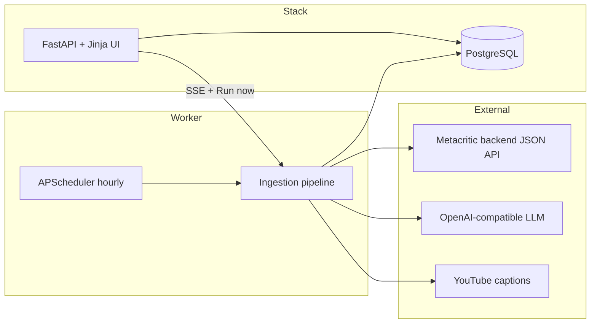
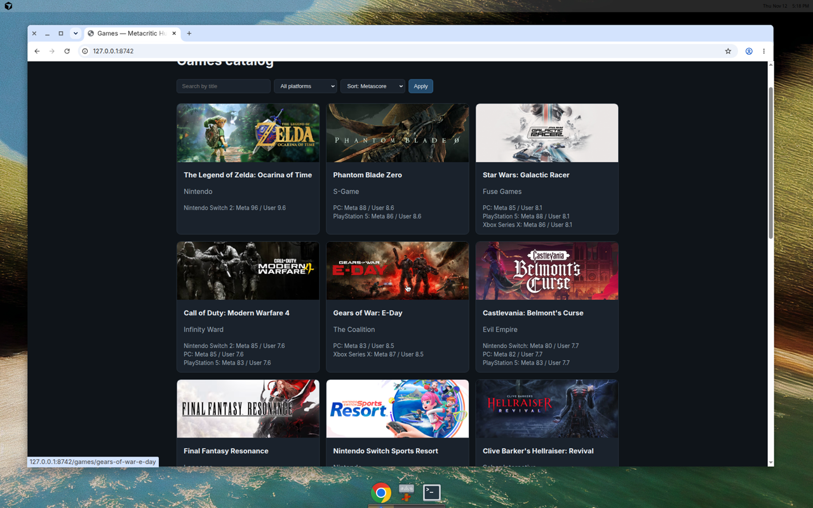
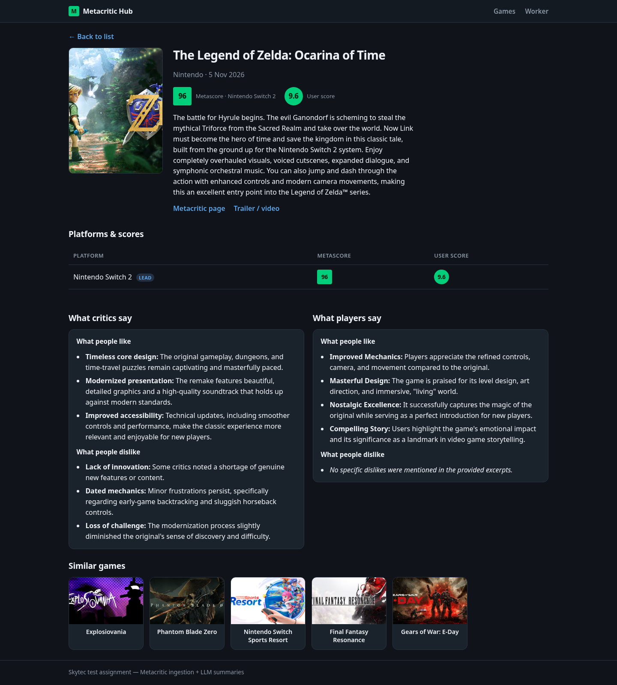
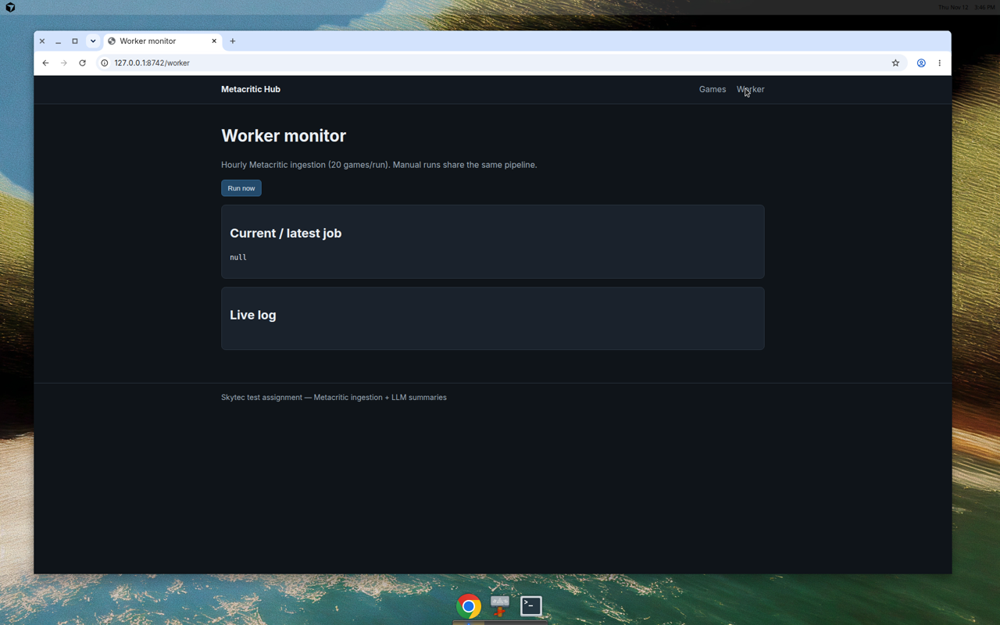

# Metacritic Games Hub

End-to-end test assignment for **Skytec Games — AI Automation Engineer**: hourly Metacritic ingestion, LLM review summaries, searchable game catalog, similar games, optional YouTube let's-play takeaways, and a live worker monitor with **Run now**.

**Кратко (RU):** Сервис раз в час подтягивает до 20 новых игр с Metacritic (JSON API + страница New Releases), сохраняет в PostgreSQL, генерирует краткие выводы по отзывам критиков и игроков (LLM или эвристика), показывает веб-каталог с фильтрами и похожими играми, плюс страница мониторинга воркера.

## Architecture



| Component | Role |
|-----------|------|
| `worker/main.py` | APScheduler interval job + startup run |
| `app/services/metacritic.py` | List pages + `backend.metacritic.com` JSON |
| `app/services/ingestion.py` | Daily routing, dedup, upsert, job logs |
| `app/services/llm.py` | Critics/users summaries; fallback without API key |
| `app/services/similar.py` | TF-IDF cosine similarity |
| `app/services/youtube.py` | Search + `youtube-transcript-api` (bonus) |
| `app/routes/web.py` | List, detail, filters, sort |
| `app/routes/api.py` | `POST /api/worker/run-now`, SSE `/api/worker/events` |

### Scheduling & “not processed today” dedup

- Table `daily_run_states` stores **per calendar day**:
  - `used_new_releases` — first run uses [New Releases](https://www.metacritic.com/browse/game/release-date/new-releases/all/) HTML slugs.
  - `browse_offset` — later runs paginate Metacritic **finder** API (`sortBy=-releaseDate`, +20 offset per run).
  - `processed_slugs_today` — slugs already ingested today; each run takes up to `GAMES_PER_RUN` (default **20**) new slugs.
- Existing games are **updated** (scores, summaries) if seen again.

### Metacritic data source

We use Metacritic’s public **backend JSON API** (same as their web app), not brittle HTML product pages:

- Finder list (newest games)
- Product, per-platform user stats, critic/user review lists
- New Releases browse page for the first daily run (assignment requirement)

Verified in this environment:

```bash
python -m scripts.verify_scraper
```

## Quick start

### Docker Compose (recommended)

```bash
cp .env.example .env
docker compose up --build
```

- App: http://localhost:8742  
- Worker monitor: http://localhost:8742/worker  

Services: `db` (Postgres 16), `app` (Uvicorn + optional `RUN_SCHEDULER`), legacy `worker` service optional.

### Local dev (SQLite)

```bash
pip install -r requirements.txt
cp .env.example .env
export DATABASE_URL=sqlite:////workspace/metacritic.db  # or ./metacritic.db
python -m scripts.init_db
python -m scripts.seed          # 3 demo games
uvicorn app.main:app --host 0.0.0.0 --port 8742
# optional second terminal:
python -m worker.main
```

## Configuration

See `.env.example`. Important:

| Variable | Description |
|----------|-------------|
| `DATABASE_URL` | Postgres in Docker; SQLite for local dev |
| `LLM_BASE_URL`, `LLM_API_KEY`, `LLM_MODEL` | OpenAI-compatible chat API |
| `GAMES_PER_RUN` | Games per scheduled/manual run (20) |
| `SCHEDULER_INTERVAL_MINUTES` | Default 60 |
| `SCRAPER_ENABLED` | `false` = no network scrape |

Without `LLM_API_KEY`, summaries use **quote-based heuristics** (still useful for demo).

## UI features

- **Games list** — search by title, filter platform, sort by Metascore / title / release
- **Game detail** — cover, platforms with Metascore & user score, developer, description, trailer link, critic/user LLM summaries, similar games
- **Worker** — live SSE log stream, **Run now** triggers same pipeline as the scheduler

### Screenshots

| Games list | Game detail | Worker monitor |
|------------|-------------|----------------|
|  |  |  |

## Tests

```bash
pytest
```

Parsing tests use fixtures under `tests/fixtures/` (HTML + JSON).

## Deployment

See **[DEPLOY.md](./DEPLOY.md)** for Railway / Render / Fly.io / VPS steps.

## Deliverables checklist (assignment)

| Item | Status |
|------|--------|
| Hourly ingestion, 20 games/run, daily new-releases vs browse paging | Done |
| Full game fields + per-platform scores | Done |
| LLM critic/user summaries + fallback | Done |
| Web UI list/detail/filter/search/sort/similar | Done |
| Worker monitor + manual run (required) | Done |
| YouTube let's-play takeaway (bonus) | Done (best-effort; needs captions) |
| `docker compose up` | Config ready (Docker not available in cloud build VM) |
| Seed data + live scrape verified | Done |
| pytest on parsers | Done |
| DEPLOY.md | Done |

### Live service URL

Deploy with `docker compose` or [DEPLOY.md](./DEPLOY.md); set your public URL in the submission (e.g. Railway/Render). This cloud dev session exposes preview at port **8742** during the agent run.

### AI chat history

Export from **Cursor** (this agent thread) as JSONL for the employer’s “full AI chat history” deliverable — it is not stored in the repo (no secrets).

## License

MIT (test assignment).
